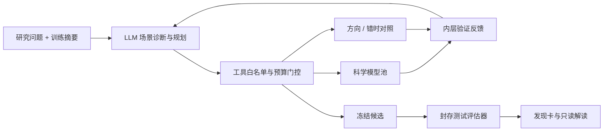

# 架构、迁移和预算

两类模型分工：大模型处理研究问题、场景摘要和下一步选择；科学模型计算数值预测。当前最小模型池包含加性 Logistic 与交互项 Logistic，3 路线 × 4 滞后 × 2 模型 = 24 候选。没有声称已经包含随机森林、图神经网络、过程模型或照片识别。扩展时增加 model registry 和 fit/predict 实现，固定输入协议后重新验证。

真实 LLM 每次只返回 tool、arguments、rationale。可用工具 inspect_data、select_models、evaluate_hypothesis、negative_control、finish。选中模型后才允许运行；每次候选和负对照消耗 1 次拟合；至少比较两种模型、完成赢家反向及错时对照后才能冻结。测试只在冻结后计算，结果缓存；最终文字解读不能再规划。

默认 B=8，规划调用最多 B+5，单次最多输出800 tokens，单次超时45秒；循环在每轮前检查240秒时限，在途调用可能再延长至45秒。解读另计1次/900 tokens。供应商用量缺失标为未知。未做严格总token/费用硬上限，实际费用依供应商计价和输入长度。

规则演示中启发式和随机分别执行 B 次候选拟合，测试与固定对照另计。两模式预算口径不同，不用于直接比较效率。20种子结果是规则策略测试，不是 LLM 测试。

## 原项目核查版本

仓库：https://github.com/Haoliu9427/GlobalHAB-Agent-demo

代码查询版本：319e1c05e8c8a0d7bd636af34c7f0b1202bdd827，查阅日期 2026-10-18。

| 原文件 / 机制 | 珊瑚版 |
| --- | --- |
| src/globalhab_demo/agent.py：反馈相似性与覆盖 | dist/engine.js：规则模式、自适应与随机对照 |
| src/globalhab_demo/scientific_agent.py：科学工具规划与冻结 | dist/planner.js：最小白名单协议与模型门控 |
| src/globalhab_demo/platform_models.py：服务端模型目录 | server/llm.mjs + scripts/start-with-secrets.py |
| real_training/remote_qwen.py：Chat Completions | server/llm.mjs：HTTPS/Bearer、temperature=0、max_tokens、visible content |
| ModelScope Qwen 非思考参数 | enable_thinking=false |
| DeepSeek 稳定输出参数 | thinking.type=disabled、reasoning_effort=none |
| 服务不可用时显式失败 | 不静默切换规则模式，不读取 reasoning_content 作为最终回答 |

配置形态兼容并不保证每个供应商接受所有参数；具体模型权限须通过“检查模型连接”验证。未复制原项目真实 HAB 成绩。当前测试包含注入模拟服务，远程服务尚未实测。

## 隔离范围

原始调查文件不上传。LLM 能见训练摘要、候选空间、已完成验证指标；不能调用测试工具。浏览器中的分区是流程隔离，公开合成代码不提供对蓄意读取测试标签的安全防护。正式盲测需要独立进程或服务保管测试标签。本地服务器仅监听127.0.0.1；若改成公网服务，需要单独设计认证、配额和会话隔离。

## v1.1 新增研究路线

`compound.js` 提供独立化学合成器、按可用字段过滤的候选和匹配对照。`research.js` 保存七条证据摘要；`planner.js` 按研究路线分派模型、评分函数与允许的对照。`compound-ui.js` 展示情景与字段门控，`reef-map.js` 负责地理上下文。详见 [研究更新](RESEARCH_UPDATE.md)。

## v1.2 连接与地图配置

`dist/llm-client.js` 共用 Chat Completions 适配与系统约束；`model-setup.js` 管理本页 Token 和真实生成检查。公开页面的 Worker 直连固定 ModelScope 域名；Token 通过独立 transport 对象传递，永不并入研究 config。规划器额外对白名单配置字段做筛选。旧版服务端目录与本地调用继续使用同一适配器。配置改变后撤销连接成功状态，运行中锁定连接字段，停止操作销毁 Worker。

`atlas-config.js` 校验官方链接与坐标，仅把非密钥的定位偏好存入浏览器本地存储。地理入口配置与合成研究数据互不改写。
